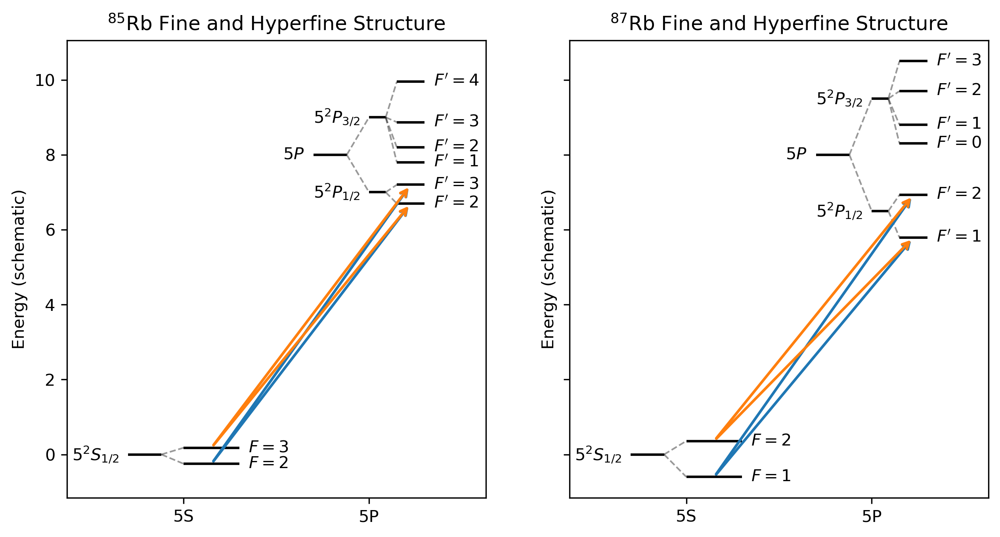

# Grotrian

**A Python tool for creating spectroscopic energy-level diagrams from YAML.**

Grotrian generates customizable energy-level diagrams using Matplotlib. Define atomic states, hierarchical fine and hyperfine structure, and transitions in a readable YAML file. Produces a figure suitable for analysis, presentations, or publication.

## Example

The example below illustrates the fine and hyperfine structure of the \(^{87}\mathrm{Rb}\) \(5P\) manifold, including the D1 and D2 transition families. It demonstrates nested level splitting, inherited column positions, and explicitly defined transitions.



## Quick start

### 1. Install dependencies

Python 3.10 or newer is recommended.

```bash
python -m pip install matplotlib PyYAML
```

### 2. Generate a diagram

Clone the repository and run the following from its root directory:

```python
import matplotlib.pyplot as plt
from grotrian import Grotrian

diagram = Grotrian("input_files/rubidium-87.yaml")
ax = diagram.draw()

plt.show()
```

That's it! The diagram is defined entirely by the YAML input file.

To save the figure instead of displaying it:

```python
ax.figure.savefig("rubidium87.png", dpi=300, bbox_inches="tight")
```

## Using Grotrian in a Jupyter notebook

Grotrian works with Matplotlib axes, so it integrates naturally with Jupyter notebooks and existing plotting workflows.

```python
import matplotlib.pyplot as plt
from grotrian import Grotrian

%matplotlib inline

diagram = Grotrian("input_files/rubidium-87.yaml")
diagram.draw()
```

You can also draw a diagram in a specific subplot:

```python
fig, ax = plt.subplots(figsize=(8, 6))

diagram = Grotrian("input_files/rubidium-87.yaml")
diagram.draw(ax=ax)

fig.tight_layout()
```

This makes it possible to combine energy-level diagrams with spectra, fitting results, or other experimental data in a single figure.

## YAML input format

Grotrian uses a versioned YAML format. A minimal input file looks like this:

```yaml
format: grotrian
version: 1

diagram:
  title: "Example diagram"
  vertical_axis:
    property: "Energy"
    unit: "cm^-1"
  horizontal_axis:
    order: ["S", "P"]

levels:
  - id: ground
    label: "$^2S_{1/2}$"
    col: "S"
    energy: 0.0

  - id: excited
    label: "$^2P_{1/2}$"
    col: "P"
    energy: 10000.0

transitions:
  - from: ground
    to: excited
    color: "tab:blue"
    linewidth: 1.5
```

### Energy levels

Each level has a unique `id`, a display `label`, a column `col`, and an energy.

- `energy` specifies the absolute energy of a level.
- `split` defines child levels, allowing hierarchical structure.
- `offset` specifies a child's energy relative to its parent.
- `show` controls whether an individual level is drawn.
- `col` specifies the horizontal column. Child levels inherit their parent's column.

For example, a fine-structure level can contain hyperfine sublevels:

```yaml
- id: P12
  label: "$^2P_{1/2}$"
  offset: -0.10
  split:
    - id: P12_F1
      label: "$F'=1$"
      offset: -0.071
    - id: P12_F2
      label: "$F'=2$"
      offset: 0.043
```

Offsets accumulate through the hierarchy, so each sublevel's absolute energy is calculated from its ancestors.

### Transitions

Transitions are specified explicitly using the IDs of their source and target levels:

```yaml
transitions:
  - from: ground_F1
    to: P12_F2
    color: "tab:blue"
    linewidth: 1.8
```

Transition colors and line widths can be customized independently. Automatic transition generation and selection-rule enforcement are not currently performed.

## Examples

The `input_files/` directory contains YAML files demonstrating Grotrian's features. The rubidium examples use schematic energy values for visual clarity. They are demonstrations of the plotting format, not precision spectroscopic references.

## Dependencies

- [Python](https://www.python.org/)
- [Matplotlib](https://matplotlib.org/) — plotting and figure generation.
- [PyYAML](https://pyyaml.org/) — reading YAML input files.

## Contributing

Contributions, bug reports, and suggestions are welcome. If you encounter a problem or have an idea for improving the input format or diagram layout, please open an issue or submit a pull request.

